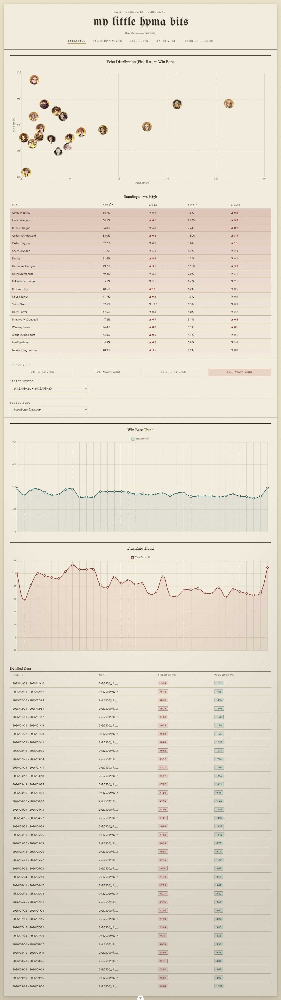
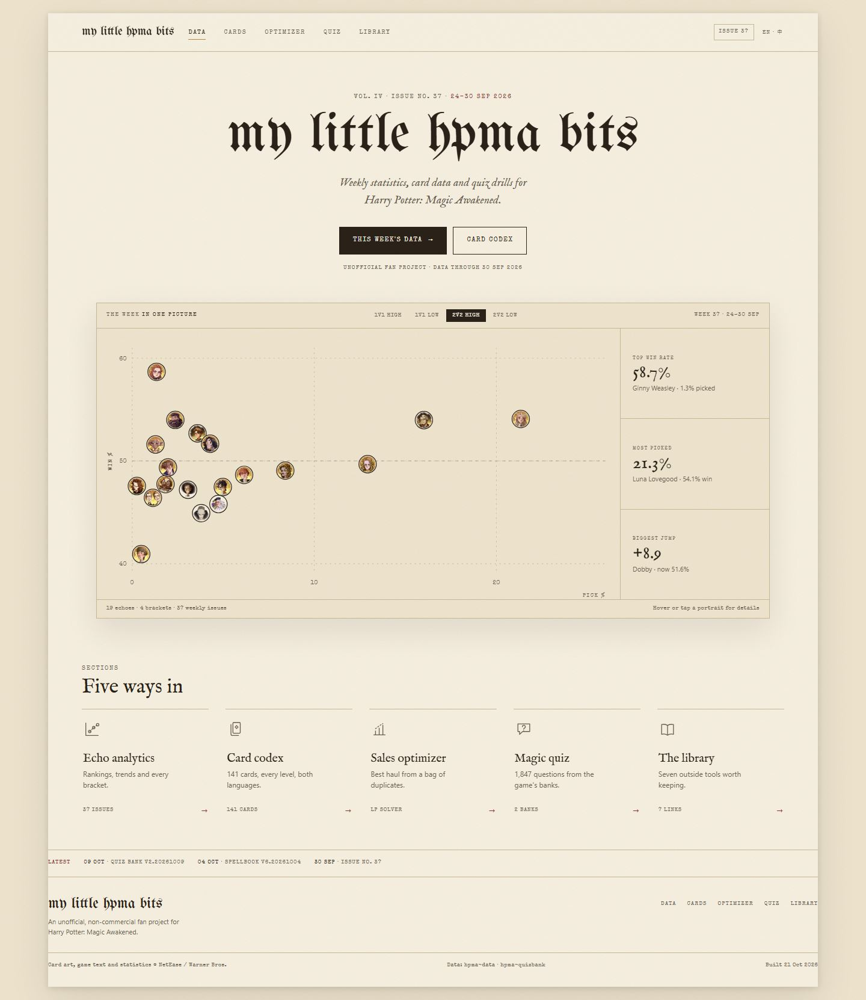
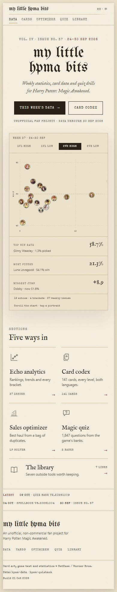

# 首页重构：从「竖向仪表盘」到「产品展示页」

> 状态：设计稿 + 可交互原型（未改动线上 `src/`）
>
> 分支：`feat/home-front-page`
>
> 原型：`docs/design/home.html`（真实存档数据，四种模式可切换）
>
> 数据：`docs/design/gen-data.mjs` 从 `public/archive/trends.json` 生成 `home.data.js`

---

## 0. 摘要

现在的 `/` 不是首页，是「分析页」：第一屏一张 700px 高的散点图，往下依次堆排行表、筛选器、趋势图、明细表，总高约 5100px。它的问题不是不好看，而是**没有回答首页该回答的三个问题**：这是什么、这里有什么、我该从哪里进去。

第一版方案按「报纸头版」重排，信息是足了，但读完像一篇社论：头条、导语、正文、图注、简讯，全是字。这一版推翻重来，参考 MAA 与 BetterGI 的首页结构：

- **MAA**：标题 + 一句话 + 一张巨大的产品截图 + 四个入口按钮。没有功能介绍，没有正文。
- **BetterGI**：Logo + 标题 + 一句话 + 两个按钮 + 四列图标卡片（每张卡片只有标题和两行说明）。

共同点：**一个屏幕只讲一件事；文字只做标签，不做叙述；产品本身（截图/图标/数据）承担信息量。**

新头版 1662px 高（移动端 1963px），首屏是品牌 + 一句话 + 两个入口 + 一张可交互的「本周格局」图；第二屏是五个入口；最后是一行更新与页脚。没有正文段落。

| 之前                                       | 之后                                   |
| ------------------------------------------ | -------------------------------------- |
|  |  |

移动端：

---

## 1. 参考对象拆解

| 组件     | MAA                                     | BetterGI                        | 本站对应                      |
| -------- | --------------------------------------- | ------------------------------- | ----------------------------- |
| 顶部导航 | 极简，几乎只有语言/主题                 | Logo + 5 个栏目 + 搜索 + GitHub | 品牌 + 5 个栏目 + 期号 + 语言 |
| Hero     | 大标题 + 一句副标题                     | Logo + 大标题 + 一句介绍        | 报头字 + 一句定位             |
| 主视觉   | 整张软件截图                            | 吉祥物插画                      | 本周散点图（产品本身）        |
| 入口     | 4 个按钮（下载/文档/QQ/Discord/GitHub） | 4 列功能图标网格                | 5 个工具卡                    |
| 正文     | 几乎没有                                | 每张卡 1–2 行                   | 每张卡 1 行                   |
| 页脚     | 一行协议                                | 主题署名                        | 一行链接 + 一行版权           |

**借**：留白、单屏叙事、图标卡片、按钮层级、极短文案。

**不借**：下载按钮（本站没有客户端）、吉祥物插画（与数据站气质不符）、搜索框（没有站内搜索就不放）、社区按钮（没有 QQ/Discord 群）。

**保留**：纸色、墨色、三种字体、纸纹。这是本站与 MAA/BetterGI 的差异所在——结构学他们，气质仍是「魔法世界的档案室」。

---

## 2. 现状诊断（保留）

1. **首屏没有结论**：第一眼是图表，标题只说明画了什么，不说明发生了什么。
2. **没有入口**：除了 5 个文字 tab，没有任何地方解释 Card Codex / Quiz / Sales Optimizer 是什么。
3. **没有出处**：没有最后更新、数据版本、样本量、免责声明。
4. **重复**：Standings 与 Detailed Data 两张表；模式名一屏出现三次。
5. **层级平**：所有标题 16–20px，靠加框而不是字级区分。
6. **密度低**：5100px 高度里大量均匀 padding，而不是信息。

---

## 3. 设计原则

1. **3 秒规则**：首屏必须回答「是什么、有什么、点哪」。
2. **文字只做标签**：标题、短句、按钮、卡片标题；不写导语，不写正文，不写图注段落。
3. **数据即视觉**：首页的主视觉不是插画，而是真实的本周散点；19 个头像比一段文字更有信息量。
4. **一个屏幕一个主张**：Hero 只讲「这是什么」，Sections 只讲「有什么」，Updates 只讲「最近改了什么」。
5. **留白是构图**：区块间距 56–88px；卡片不画框，用 1px 顶线和间距组织。
6. **不制造假功能**：没有搜索就不放搜索框，没有下载就不放下载按钮。

---

## 4. 信息架构

### 4.1 路由

| 路径                                             | 页面            | 变化                  |
| ------------------------------------------------ | --------------- | --------------------- |
| `/`                                              | `Home.vue`      | 新增头版              |
| `/analytics`                                     | `Analytics.vue` | 现 `/` 的内容整体迁移 |
| `/cards` `/sales-optimizer` `/quiz` `/resources` | 不变            | —                     |

`netlify.toml` 的 SPA catch-all 已覆盖 `/analytics`；`sitemap.js` 增加一条即可。

### 4.2 页面结构

| #   | 区块     | 内容                                         | 数据                        | 高度（桌面） |
| --- | -------- | -------------------------------------------- | --------------------------- | ------------ |
| 1   | Top bar  | 品牌、5 个栏目、期号、语言                   | 静态 + `edition`            | 64px，sticky |
| 2   | Hero     | kicker、报头字、一句定位、两个按钮、一行状态 | `edition` / `currentPeriod` | ~330px       |
| 3   | Showcase | 四档切换 + 散点 + 三个数字 + 一行计数        | `trends.json`               | ~500px       |
| 4   | Sections | 5 张工具卡（图标 / 标题 / 一行 / 计数）      | manifests / 静态            | ~330px       |
| 5   | Updates  | 三行版本日期                                 | version.json / 静态         | 54px         |
| 6   | Footer   | 字标、一行说明、导航、版权                   | 静态                        | ~170px       |

### 4.3 线框

```
┌──────────────────────────────────────────────────────────────┐
│ my little hpma bits   DATA  CARDS  OPTIMIZER  QUIZ  LIBRARY  │
│                                          [ISSUE 37]  EN · 中  │
├──────────────────────────────────────────────────────────────┤
│              VOL. IV · ISSUE NO. 37 · 24–30 SEP 2026          │
│                                                              │
│                  m y  l i t t l e  h p m a  b i t s          │
│                                                              │
│            Weekly statistics, card data and quiz drills      │
│                 for Harry Potter: Magic Awakened.            │
│                                                              │
│              [ THIS WEEK'S DATA → ]  [ CARD CODEX ]          │
│           UNOFFICIAL FAN PROJECT · DATA THROUGH 30 SEP       │
│                                                              │
│  ┌────────────────────────────────────────────┬───────────┐  │
│  │ THE WEEK IN ONE PICTURE  [1v1][1v1][2v2]   │ TOP WIN   │  │
│  │                                            │ 58.7%     │  │
│  │        ·  ·   ·        ·        ·          │ Ginny     │  │
│  │     ·    ·  ·    ·   ·                     ├───────────┤  │
│  │        ·   ·   ·                           │ MOST PICK │  │
│  │                                            │ 21.3%     │  │
│  │                                            ├───────────┤  │
│  │                                            │ BIGGEST   │  │
│  │  19 echoes · 4 brackets · 37 issues        │ +8.9      │  │
│  └────────────────────────────────────────────┴───────────┘  │
├──────────────────────────────────────────────────────────────┤
│ SECTIONS                                                     │
│ Five ways in                                                 │
│ ┌────────┬────────┬────────┬────────┬────────┐               │
│ │ icon   │ icon   │ icon   │ icon   │ icon   │               │
│ │ Echo   │ Card   │ Sales  │ Magic  │ The    │               │
│ │ analytics codex │ optimizer quiz  │ library│               │
│ │ 1 line │ 1 line │ 1 line │ 1 line │ 1 line │               │
│ └────────┴────────┴────────┴────────┴────────┘               │
├──────────────────────────────────────────────────────────────┤
│ LATEST   09 Oct · Quiz · 04 Oct · Spellbook · 30 Sep · Issue │
├──────────────────────────────────────────────────────────────┤
│ my little hpma bits                    DATA CARDS … LIBRARY  │
│ An unofficial, non-commercial fan project.                   │
│ © NetEase / Warner Bros. · Data: hpma-data · Built 21 Oct    │
└──────────────────────────────────────────────────────────────┘
```

### 4.4 首屏折叠线

1440×900 内可见：导航、报头、一句话、两个按钮、Showcase 的上半部分（模式切换 + 图表上半区 + 第一个数字）。1440×1080 可见完整主视觉。这是刻意的：主视觉要压着折叠线出现，让人想往下滚。

---

## 5. 版面与视觉

### 5.1 尺寸

- 纸面 **1280px**，左右留白 `clamp(20px, 4.4vw, 56px)`。
- Showcase **1120px**，占满内容宽。
- 5 栏工具网格，列间距 `clamp(14px, 2.2vw, 28px)`。
- 主要间距：hero 顶 64px、Showcase 上 44px、Sections 上 72px、Updates 上 48px、页脚 32px。

### 5.2 字阶

| 角色        | 字体               | 字号                       | 数量         |
| ----------- | ------------------ | -------------------------- | ------------ |
| 报头        | UnifrakturMaguntia | `clamp(54px, 7.3vw, 92px)` | 1            |
| 区块标题    | IM Fell English    | 34px                       | 1            |
| 工具卡标题  | IM Fell English    | 20px                       | 5            |
| 一句定位    | IM Fell italic     | 19px                       | 1（2 行）    |
| 数字        | IM Fell            | 30px                       | 3            |
| 卡片说明    | system sans        | 12px                       | 5（各 1 行） |
| 标签 / 计数 | Special Elite      | 8.5–10px                   | 多处         |

全页只有一句定位、5 条卡片说明和页脚一句，没有正文段落。其余都是标签、数字和标题。

### 5.3 颜色

- 纸 `--paper-light` 铺满，Showcase 用深一档的 `--paper` 做「屏幕」。
- 墨只用于文字、主按钮。
- `--oxblood` 只给：卡片箭头、LATEST 标签、当前栏目标记、悬停描边。
- `--gold-leaf` 只给：导航下划线、Showcase 数字点的高亮环。
- 全页唯一反白色块：主按钮。没有深色页脚、没有深色卡片。

### 5.4 图标

5 个 30px 线性图标，统一 1.4px 描边、圆角线帽：散点坐标轴、叠放卡牌、上升柱、问号气泡、打开的书。悬停时变 oxblood 并上移 2px。

### 5.5 动效

- 报头 0.9s 落版（settle），Showcase 0.7s 上浮。
- 卡片悬停 0.2s，图标位移 2px，箭头右移 4px。
- 数字悬停联动散点：给对应点加金色描边（不新增文字）。
- `prefers-reduced-motion` 全关。

### 5.6 响应式

| 断点 | 变化                                                                                     |
| ---- | ---------------------------------------------------------------------------------------- |
| ≤980 | Showcase 右栏改到图下，三等分；工具网格 3 列                                             |
| ≤760 | 导航换行成第二行；工具网格 2 列；Showcase 数字改为「标签 + 值 + 人名」三行；散点横向拖动 |
| ≤380 | 工具网格 1 列；按钮纵向铺满                                                              |

移动端散点保持 520px 最小宽、允许横向拖动；右侧三个数字始终可见，所以即使不拖也能读到结论。

---

## 6. 交互

- **四档模式**：点击切换整张图 + 三个数字，不换页。
- **悬停 / 点按头像**：显示「名字 · 胜率 · 选取率」小浮层。
- **悬停数字**：对应头像亮起金色描边，建立「数字 ↔ 点」的对应。
- **sticky 导航**：滚动后出现细阴影。
- **不做**：轮播、自动播放、假搜索、滚动动画、弹窗。

---

## 7. 组件与状态

### 7.1 组件树

```
App.vue
├─ SiteHeader.vue          ← 由 Header.vue 拆分（品牌 + 栏目 + 期号 + 语言）
├─ Home.vue
│  ├─ HeroBlock.vue        ← 报头字 / 一句定位 / 按钮
│  ├─ WeekShowcase.vue     ← 模式切换 + 图 + 数字
│  │  ├─ MetaScatter.vue
│  │  └─ StatRail.vue
│  ├─ ToolGrid.vue → ToolCard.vue
│  ├─ UpdatesStrip.vue
│  └─ SiteFooter.vue
```

### 7.2 文件与 props

| 文件                               | 职责                   | props                             |
| ---------------------------------- | ---------------------- | --------------------------------- |
| `views/Home.vue`                   | 组装与数据加载         | —                                 |
| `components/site/SiteHeader.vue`   | 品牌、栏目、期号、语言 | `edition`, `compact`              |
| `components/home/WeekShowcase.vue` | 模式状态 + 图 + 数字   | `rowsByMode`, `edition`, `period` |
| `components/home/MetaScatter.vue`  | 纯 SVG 散点 + tooltip  | `rows`, `focus`                   |
| `components/home/StatRail.vue`     | 三个数字               | `stats`，emit `highlight`         |
| `components/home/ToolGrid.vue`     | 5 个入口               | `items`                           |
| `components/home/UpdatesStrip.vue` | 版本行                 | `items`                           |
| `components/site/SiteFooter.vue`   | 页脚                   | —                                 |

### 7.3 状态

`src/stores/homeStore.js`：

```js
state: {
  mode: '2v2-high';
}
getters: {
  (edition, period, rows, topWin, topPick, topJump); // 三个数字，直接取极值
}
actions: {
  setMode(mode);
}
```

不需要「头条生成器」。这版首页不写观点，只展示极值和分布，因此**没有编造文案的风险**。样本量提示由数字旁的人名和「% picked」承担。

### 7.4 数据与性能

- 首页只读 `trends.json`（约 57KB）+ 两个 `manifest.json`（各约 3KB）。**不加载** `cards.json`（3.9MB）和 `quiz.json`（2MB）。
- 图用内联 SVG，不引入 Chart.js；首页 JS 里没有图表库。
- 头像 24px，`loading="lazy"`；首屏只加载 19 张 2.5KB 的 WebP。
- 首屏无阻塞字体：报头字预加载，其余 `font-display: swap`。
- 目标：LCP < 2.0s（Fast 4G），CLS < 0.05，首页 JS < 40KB gzip。

---

## 8. 实施阶段

| 阶段 | 内容                                                     | 估时     |
| ---- | -------------------------------------------------------- | -------- |
| P0   | 路由拆分 `/` ↔ `/analytics`；导航与 sitemap 同步         | 0.5 人日 |
| P1   | SiteHeader + Hero + WeekShowcase（SVG 散点、模式、数字） | 2 人日   |
| P2   | ToolGrid + UpdatesStrip + Footer + 响应式 + 数据接入     | 1.5 人日 |
| P3   | 键盘/读屏、打印、性能预算、中文文案                      | 1 人日   |

### 验收

- [ ] 1440×900 首屏可见：报头、一句话、两个按钮、Showcase 上半。
- [ ] 四档切换后，图与三个数字同步更新。
- [ ] 首页不请求 `cards.json` / `quiz.json`，JS 不含 Chart.js。
- [ ] 390 / 760 / 980 / 1440 四档无溢出；移动端导航完整可见。
- [ ] 键盘可切换模式、可聚焦散点；`prefers-reduced-motion` 无动效。
- [ ] 页脚含数据来源、版权、构建时间。
- [ ] LCP < 2.0s，CLS < 0.05。

---

## 9. 风险与取舍

| 风险                     | 应对                                                                    |
| ------------------------ | ----------------------------------------------------------------------- |
| 页面太空，显得没内容     | 主视觉必须是真数据；三个数字要足够大；留白按 64–88px 控制，不靠加卡片填 |
| 移动端散点被裁           | 允许横向拖动；三个数字固定在图下，保证结论可读                          |
| 纸质气质与「工具站」不搭 | 结构学 MAA/BetterGI，材质保留纸与铅字；不做深色霓虹                     |
| 5 个入口不够             | 首页只负责「发现」，完整信息在 `/analytics`；后续可加搜索               |
| 首屏数字被误读           | 数字旁始终写人名与样本（`1.3% picked`），不写「最强」等结论             |

**明确不做**：正文式头条、图注段落、更新日志详情、社区按钮、下载按钮、搜索框、轮播。

---

## 10. 原型说明

- 打开：`npm run dev`，访问 `/docs/design/home.html`。
- 交互：四档模式切换、散点悬停/聚焦浮层、数字悬停联动头像、sticky 导航。
- 数据：`docs/design/home.data.js` 由 `node docs/design/gen-data.mjs` 生成，口径与 `DataService` 一致（`[period, echo, mode, win, pick]`）。
- 原型中「THIS WEEK'S DATA」与导航「DATA」都指向 `/`（当前的 Analytics）。落地后改为 `/analytics`。
- 语言按钮是位置占位；真实切换由站点 shell 的 `LocaleSwitch` 接管。
- 原型是一次性设计验证物，不进入构建。

---

## 11. 开放问题

1. 主视觉用散点，还是改成「三张卡 + 一张榜单」的拼贴？散点信息量最大，但小屏需要拖动。
2. 是否给三个数字加一行「样本 < 3% 时提示」的规则，而不只是 `% picked`？
3. 中文版的一句定位需要单独写，直译会生硬。
4. 页脚是否需要 GitHub 入口？（当前仓库没有公开地址，暂不放。）
