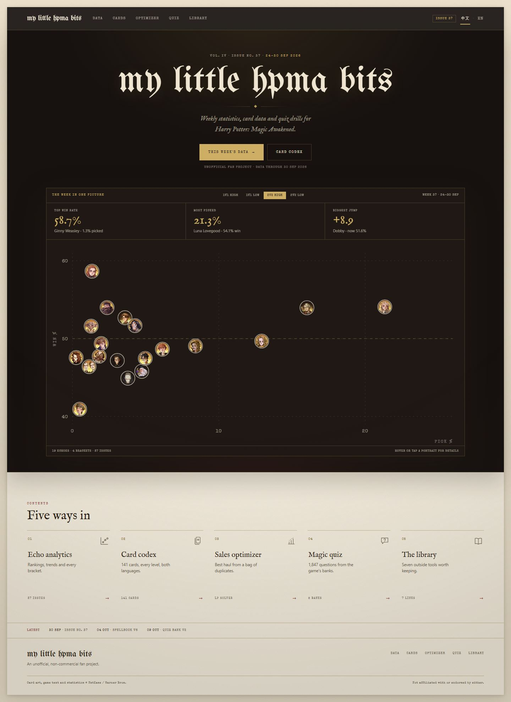
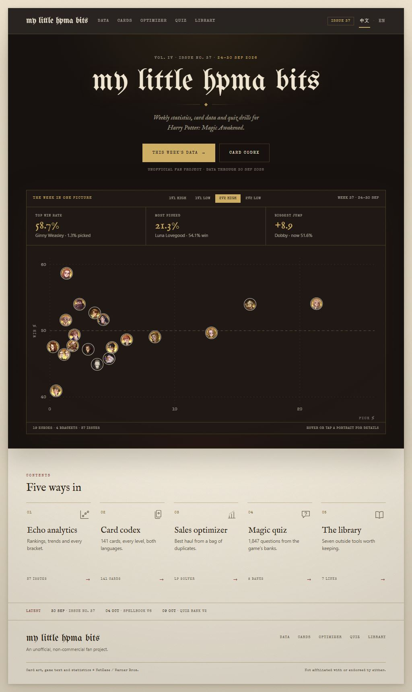
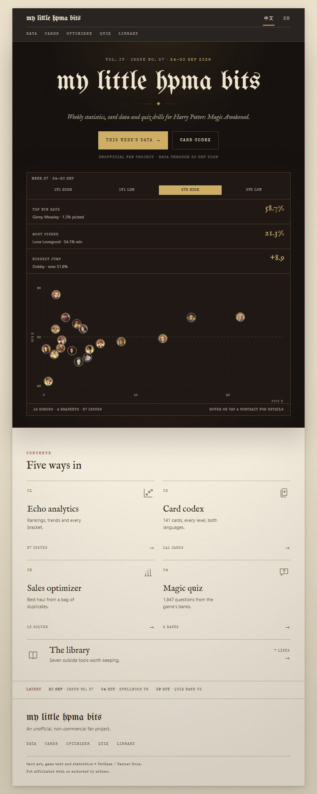
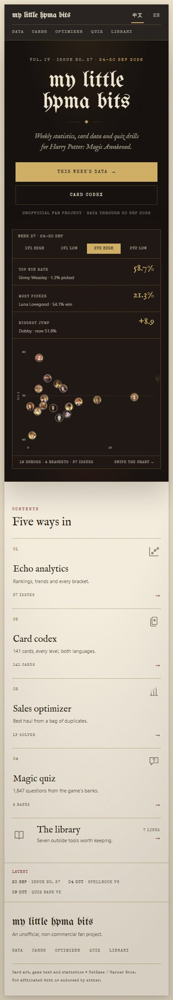

# 首页重构：一本数据年鉴的封面与目录

> 状态：已实现（`feat/home-front-page`）
>
> 分支：`feat/home-front-page`
>
> 实现：`src/views/Home.vue` + `src/components/home/*` + `src/components/site/*`
>
> 静态原型：`docs/design/home.html`（视觉基准，不进入构建）
>
> 数据：`node docs/design/gen-data.mjs` 从 `public/archive/trends.json` 生成 `home.data.js`

---

## 0. 摘要

结构已经定了：**封面 → 一张本周数据图 → 五个入口 → 更新行 → 页脚**。这一轮只做美术方向。

上一版是浅色纸面 + 标题 + 五个卡片，结构对了，但视觉上太平：一整页同一种米色，没有焦点，也没有记忆点。这一版把首页做成一本**书的封面与目录**：

- **上半部是封面**：深墨底、奶油字、金线。报头字是唯一的大图形，下面只有一句定位、两个入口，和一块镶金边的「本周数据版画」。
- **下半部是目录**：回到既有纸色，五个编号栏目，一行更新，一个安静的页脚。

整页 1974px（移动端 2250px），没有任何正文段落。深色只出现在封面，正文区仍是原来那套纸与墨——翻开封面，还是同一本书。

| 之前                                       | 之后                                 |
| ------------------------------------------ | ------------------------------------ |
|  |  |

移动端：

响应式实现（1440 / 1024 / 768 / 390）：

| 1440                          | 1024                          |
| ----------------------------- | ----------------------------- |
|  |  |

| 768                         | 390                         |
| --------------------------- | --------------------------- |
|  |  |

| 之前                                       | 之后                                 |
| ------------------------------------------ | ------------------------------------ |
|  |  |

移动端：

---

## 1. 设计概念

### 1.1 为什么是「封面 + 目录」

MAA 和 BetterGI 的首页都只做两件事：**亮明身份**，然后**把入口摆出来**。它们不需要在首页解释功能——截图和图标已经在解释。

本站的「产品截图」就是数据本身。于是：

- 封面承担身份：报头字、一句定位、两个按钮。
- 数据版画承担「这周发生了什么」：三个数字先给结论，19 个头像再给证据。
- 目录承担「这里有什么」：五个编号栏目，一句话，一个计数。

### 1.2 为什么用深色封面

浅色纸面是站点的底色，但首页需要一个**焦点**。深墨封面做了三件事：

1. 把报头字变成图形，而不是一行标题。
2. 让数据版画里的头像、金线、数字有对比可看。
3. 给「翻开」一个动作感：深色结束，纸色开始。

深色只此一处。卡片、页脚、内页全部保持纸色，不引入第二套暗色主题。

### 1.3 金色与奶油色

- 封面底色 `#171210`（暖墨），版画底色 `#1f1814`。
- 字用奶油 `#f4ead6`，正文次要信息用 60% 奶油。
- 金色 `#d2b266` 只做三件事：主按钮、三个数字、当前模式。
- 没有渐变霓虹、没有发光边、没有玻璃拟态。

---

## 2. 与 MAA / BetterGI 的结构对照

| 结构   | MAA                  | BetterGI                    | 本版                            |
| ------ | -------------------- | --------------------------- | ------------------------------- |
| 顶栏   | 极简                 | Logo + 栏目 + 搜索          | 品牌 + 5 栏目 + 期号 + 语言     |
| Hero   | 标题 + 一句 + 大截图 | Logo + 标题 + 一句 + 两按钮 | 报头字 + 一句 + 两按钮          |
| 主视觉 | 软件截图             | 吉祥物插画                  | 深色数据版画（三个数字 + 散点） |
| 入口   | 4 个按钮             | 4 列图标卡                  | 5 个编号栏目                    |
| 正文   | 几乎没有             | 每卡 1–2 行                 | 每卡 1 行                       |
| 页脚   | 一行协议             | 主题署名                    | 一行链接 + 一行版权             |

借结构，不借皮肤。封面是我们的，数据版画也是我们的。

---

## 3. 信息架构

### 3.1 路由

| 路径                                             | 页面            | 变化              |
| ------------------------------------------------ | --------------- | ----------------- |
| `/`                                              | `Home.vue`      | 新增              |
| `/analytics`                                     | `Analytics.vue` | 现 `/` 的内容迁移 |
| `/cards` `/sales-optimizer` `/quiz` `/resources` | 不变            | —                 |

### 3.2 区块

| #   | 区块       | 内容                                           | 数据                 |
| --- | ---------- | ---------------------------------------------- | -------------------- |
| 1   | Top bar    | 品牌、5 栏目、期号、语言；sticky               | `edition`            |
| 2   | Cover copy | 期号日期、报头字、一句定位、两个按钮、一行状态 | `edition` / `period` |
| 3   | Plate      | 四档切换 + 三个数字 + 19 人头像散点 + 计数行   | `trends.json`        |
| 4   | Contents   | 5 个编号栏目                                   | 静态 + manifests     |
| 5   | Latest     | 三行版本日期（纯文本，不放外链）               | 静态                 |
| 6   | Footer     | 字标、导航、一行版权                           | 静态                 |

### 3.3 首屏

1440×900 内可见：顶栏、报头字、一句定位、两个按钮、版画的三个数字，以及散点的上半部分。

版画刻意压着折叠线：三个数字先给结论，散点作为往下滚的理由。

---

## 4. 版面与视觉

### 4.1 尺寸

- 纸面 **1280px**，左右留白 `clamp(20px, 4.4vw, 56px)`。
- 封面通栏；版画 **1120px**，在封面内居中。
- 版权区与封面同宽，底部收在纸色上。
- 主要间距：封面顶 66px、版画上 50px、目录上 82px、页脚 32px。

### 4.2 字阶

| 角色        | 字体               | 字号                        | 颜色              |
| ----------- | ------------------ | --------------------------- | ----------------- |
| 报头        | UnifrakturMaguntia | `clamp(56px, 7.4vw, 104px)` | 奶油              |
| 目录标题    | IM Fell English    | 36px                        | 墨                |
| 栏目标题    | IM Fell English    | 21px                        | 墨                |
| 一句定位    | IM Fell italic     | 19px                        | 60% 奶油          |
| 三个数字    | IM Fell English    | 36px                        | 金                |
| 卡片说明    | system sans        | 11.5px                      | 墨 60%            |
| 标签 / 计数 | Special Elite      | 7.5–9px                     | 奶油 60% 或墨 60% |

### 4.3 版画的结构

```
┌ 1px 金线 ───────────────────────────────────────────────┐
│ THE WEEK IN ONE PICTURE   [1v1H][1v1L][2v2H][2v2L]  W37 │
├──────────────┬──────────────┬──────────────────────────┤
│ TOP WIN      │ MOST PICKED  │ BIGGEST JUMP             │
│ 58.7%        │ 21.3%        │ +8.9                     │
│ Ginny · 1.3% │ Luna · 54.1% │ Dobby · 51.6%            │
├──────────────┴──────────────┴──────────────────────────┤
│                                                          │
│       19 个头像，按选取率 × 胜率落点                     │
│                                                          │
├──────────────────────────────────────────────────────────┤
│ 19 ECHOES · 4 BRACKETS · 37 ISSUES   HOVER A PORTRAIT   │
└──────────────────────────────────────────────────────────┘
```

- 数字在图上：先给结论，再看证据。
- 散点只保留坐标轴、10 的刻度、50% 虚线和中位线；没有象限名、没有图注、没有来源行。
- 头像 24px，奶油细环；悬停时环变金色。
- 三个数字悬停时，对应头像亮金环——不新增任何文字。

### 4.4 目录

- 5 栏，`01`–`05` 编号，顶部 1px 细线；悬停时细线转金、图标转赭红、箭头右移。
- 图标 28px，1.4px 描边，同一套几何语言。
- 每栏：编号 / 图标 / 标题 / 一行说明 / 计数 + 箭头。
- 移动端 2 栏；第 5 栏横向铺满，避免落单。

### 4.5 材质与光

- 纸纹保留，但只在纸色区可见；封面靠自己的径向暖光和极浅的颗粒。
- 封面下缘向纸面投一道柔影，让「封面」像压着「内页」。
- 唯一的阴影：纸面、版画、封面投影。卡片不投阴影。

### 4.6 动效

- 报头 0.9s 落版；版画 0.8s 上浮；其余无入场动画。
- 悬停 0.2s；模式切换即时重绘，不做淡入淡出。
- `prefers-reduced-motion` 全部关闭。

### 4.7 响应式

| 断点 | 变化                                                                         |
| ---- | ---------------------------------------------------------------------------- |
| ≤980 | 目录 3 栏                                                                    |
| ≤760 | 顶栏两行；封面 66px 字；版画数字改三行；散点横向拖动；目录 2 栏；第 5 栏横铺 |
| ≤380 | 目录 1 栏；按钮纵向铺满                                                      |

移动端散点保持 520px 最小宽，允许横向拖动；版画底部有「Swipe the chart →」提示，三个数字始终在图上，所以不拖也能读到结论。

---

## 5. 数据来源的处理

按产品决定：**页面不展示数据源。**

- 页脚不再出现 `hpma-data` / `hpma-quizbank` / 版本 JSON 外链。
- 版画没有 `Source:` 行。
- Latest 只写「30 Sep · Issue No. 37」这类**期号与版本**，不写从哪来。
- 保留的只有：数据截止日期（`DATA THROUGH 30 SEP 2026`）、规模计数（19 echoes / 4 brackets / 37 issues）、版权与免责。
- 数据来源只写在工程文档和脚本注释里，不进入 UI。

---

## 6. 交互

- 四档模式：切换版画的三个数字、散点，不换页。
- 悬停 / 点按头像：奶油底浮层，显示名字、胜率、选取率。
- 悬停三个数字：对应头像亮起金环。
- sticky 顶栏：滚动后出现一层很轻的黑影。
- 不做：轮播、自动播放、假搜索、滚动动画、弹窗。

---

## 7. 组件与状态

### 7.1 组件树

```
App.vue
├─ SiteHeader.vue        ← 深色变体：品牌 + 栏目 + 期号 + 语言
├─ Home.vue
│  ├─ CoverHero.vue      ← 期号 / 报头 / 一句 / 按钮
│  ├─ WeekPlate.vue      ← 模式 + 数字 + 散点 + 计数
│  │  ├─ StatRail.vue
│  │  └─ MetaScatter.vue
│  ├─ ToolGrid.vue → ToolCard.vue
│  ├─ UpdatesStrip.vue
│  └─ SiteFooter.vue
```

### 7.2 状态

```js
state: {
  mode: '2v2-high';
}
getters: {
  (edition, period, rows, topWin, topPick, topJump);
}
actions: {
  setMode;
}
```

首页只读 `trends.json` 与两个 manifest（约 3KB），不加载 `cards.json` / `quiz.json`；图用内联 SVG，不引入 Chart.js。

### 7.3 性能预算

- LCP < 2.0s（Fast 4G），CLS < 0.05，首页 JS < 40KB gzip。
- 头像 24px、懒加载；首屏只加载 19 张约 2.5KB 的 WebP。
- 报头字预加载，其余 `font-display: swap`。

---

## 8. 实施阶段

| 阶段 | 内容                                                         | 估时     |
| ---- | ------------------------------------------------------------ | -------- |
| P0   | 路由拆分 `/` ↔ `/analytics`，导航与 sitemap                  | 0.5 人日 |
| P1   | SiteHeader + CoverHero + WeekPlate（数字 + SVG 散点 + 模式） | 2 人日   |
| P2   | ToolGrid + UpdatesStrip + Footer + 响应式                    | 1.5 人日 |
| P3   | 键盘/读屏、打印、性能预算、中文文案                          | 1 人日   |

P0–P3 已在此分支完成；LCP/CLS 仍待在部署环境实测。

### 验收

- [x] 1440×900 首屏可见报头、一句、两按钮、三个数字。
- [x] 四档切换后数字与散点同步更新。
- [x] 首页不请求 `cards.json` / `quiz.json`，JS 不含 Chart.js。
- [x] 390 / 768 / 1024 / 1440 四档无横向溢出；移动端导航完整。
- [x] 键盘可切换模式、可聚焦散点；`prefers-reduced-motion` 无动效。
- [x] 页面不出现数据源名称与外链。
- [ ] LCP < 2.0s，CLS < 0.05（待部署环境实测）。

---

## 9. 风险与取舍

| 风险                   | 应对                                            |
| ---------------------- | ----------------------------------------------- |
| 深色封面与内页割裂     | 封面是唯一深色面；内页保持原纸色，靠柔影过渡    |
| 封面太高，首屏看不到图 | 三个数字放在图上方，折叠线前先给结论            |
| 金色显得俗气           | 金色只做线、数字、主按钮；不做大面积金底        |
| 移动端散点被裁         | 允许横向拖动，数字固定在图上，并给「Swipe」提示 |
| 页面太空               | 留白按 50–82px 控制；封面只放一个视觉焦点       |
| 数据源被误认为公开     | 页面不写来源，只写截止日期与规模；来源留在文档  |

---

## 10. 实现与原型

### 已落地（2026-10-21）

- 路由：`/` → `Home.vue`，`/analytics` → 现有 `Analytics.vue`；导航、sitemap、`og:url` 同步。
- 首页组件：`CoverHero` / `WeekPlate` / `StatRail` / `MetaScatter` / `ToolGrid` / `ToolIcon` / `UpdatesStrip`。
- 全站 chrome：`SiteHeader`（首页深色、内页纸色、sticky、期号 + `LocaleSwitch`）与 `SiteFooter`；旧 `Header.vue` 移除。
- 页面标题统一为 `h1`（`PageHead`），`App` 提供唯一 `<main id="main">` 与 skip link。
- 数据：Home 固定取归档**最新一期**，不受 `/analytics` 的期号选择影响；一次 `updateAllData()`，不加载 `cards.json` / `quiz.json`，首页 chunk 18KB（gzip 7KB），不含 Chart.js。
- 细节：散点只在真正溢出时显示拖动提示（JS 测量，不靠断点猜）；期号在 header chip / plate counts / ToolGrid / UpdatesStrip 四处同源；`Biggest jump` 只在确有上涨时显示，否则 `—`。
- 验证：`npm test` 290 passed；`npm run lint` clean；`npm run build` 通过（sitemap 6 URLs）。

### 静态原型

- 打开：`npm run dev`，访问 `/docs/design/home.html`。
- 它是视觉基准：静态数据、无路由；生产实现以 `src/` 为准。
- 原型里的四档切换、头像浮层、数字联动头像在实现中保留；语言切换由全局 `SiteHeader` 的 `LocaleSwitch` 接管。
