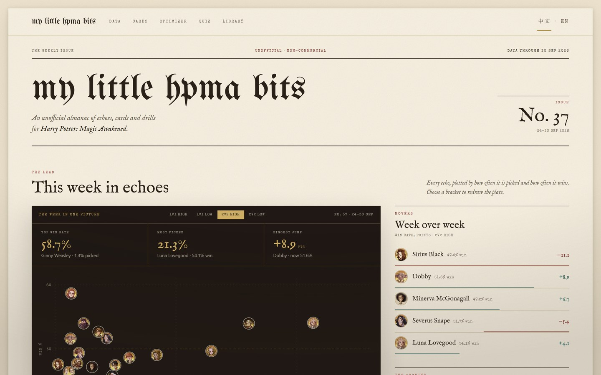
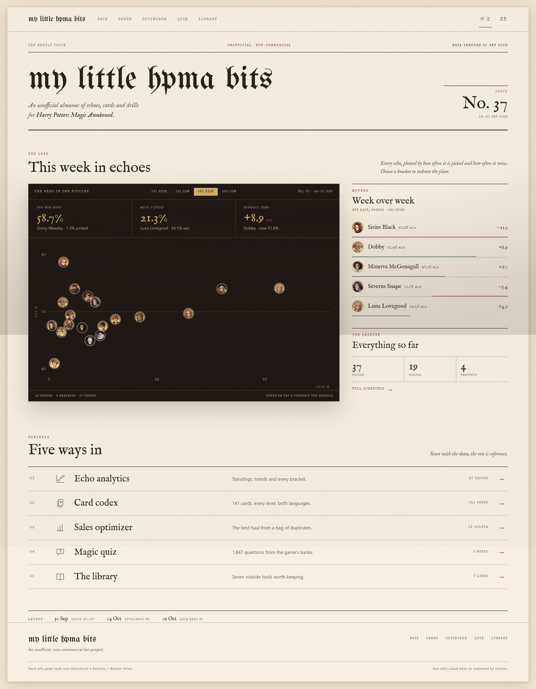

# 头版：一张纸上的周刊

> 状态：已实现（`feat/home-front-page`）
>
> 分支：`feat/home-front-page`
>
> 实现：`src/views/Home.vue` + `src/components/home/*` + `src/components/site/SiteHeader.vue`
>
> 截图：`docs/design/front-1440.jpg` / `front-1024.jpg` / `front-768.jpg` / `front-390.jpg` / `front-fold-1440.jpg`
>
> 数据快照：`public/archive/trends.json`（截图与示例数字取自 No. 37，2026/09/24–09/30；线上数据每周滚动）
>
> 2026-10-24 后续：界面已移除期号（报头改为 `DATA WEEK` + 日期，Archive/Contents 计数改为 weeks）；单回响页删除游戏 strategy / synergy 内容；Optimizer 撤销 URL state。下面的 No. 37 示例与截图保留为设计快照。

---

## 0. 摘要

上一版是「深色封面 + 目录」：海报感很强，但深色只存在于封面，滚过封面就回到另一种材质的页面；封面内部也还是居中堆叠的 SaaS hero 结构。

这一版把首页改成一张真正的**纸色头版**：

- **报头回到纸上**，左对齐；期号与日期在右。整页只有一种纸、一种墨。
- **数据版画**成为全页唯一的深色面：三个数字在上，19 个回响头像在下。它像一张印在报纸上的照片，而不是一个「深色区块」。
- 版画右侧是一条**纸色数据栏**：涨跌榜 + 档案规模。
- 目录从五张卡片改成一张横贯版面的**索引表**：编号 / 图标 / 栏目 / 一行说明 / 规模。
- 期号统一写成 `No. 37`，日期写全；去掉 `Vol. IV`，也去掉把期号误当周数的 `Week 37`。
- 全页 1852px（1440）；首屏 900px 内可见报头、Lead 标题、版画三个数字和涨跌榜前几行。

| 首屏                                        | 整页                                       |
| ------------------------------------------- | ------------------------------------------ |
|          |              |

---

## 1. 为什么这样改

### 1.1 从「封面」到「头版」

旧版的结构是「封面 + 目录」，但封面是海报：居中、对称，除了三个数字没有别的信息。头版应该是一张可以读的纸——报头告诉你是哪一期，Lead 告诉你怎么读这张图，右栏告诉你本周发生了什么变化，目录再给入口。

### 1.2 深色只做版画

旧版深色封面与内页纸色是两套材质；这一版把深色收进版画。三个好处：

1. 纸色连续，页面不再像两个站拼在一起。
2. 版画成为唯一的「图」。内页任何数据图都可以复用同一套 ink plate，这是把风格扩散到全站的关键。
3. 金色只在暗底出现（数字、刻度、active tab）；纸面上只留金线/墨线，不会显得俗。

### 1.3 为什么不做生成式头条

头版可以像报道，但自动生成一句「Dobby +8.9」容易过度解释数据，也每周不稳定。改成**涨跌榜**：数字自己说话，读者自己下结论。Lead 只保留一句方法说明。

### 1.4 为什么目录是一张表

五个栏目是并列的，不需要五张卡片。索引表一行读一个栏目，标题和说明在同一行，规模靠右、箭头收尾；它比五栏卡片更安静，也更像一份出版物的目录。

---

## 2. 结构

```text
SiteHeader（全站纸色，sticky）
Home
├─ Masthead
│  ├─ running head：The weekly issue · Unofficial / non-commercial · Data through …
│  └─ 报头字 / 一句定位 / No. 37 + 日期（3px double 收底）
├─ Lead
│  ├─ section head：The lead / This week in echoes / 方法说明
│  ├─ WeekPlate（ink plate）
│  │  ├─ 版画头：The week in one picture / 四档 / No. 37 · 24–30 Sep
│  │  ├─ StatRail：Top win rate / Most picked / Biggest jump
│  │  ├─ MetaScatter：19 个回响头像
│  │  └─ 计数行 + 操作提示
│  └─ 纸色数据栏
│     ├─ MoversRail：3 涨 + 2 跌，按 |Δ| 排序
│     └─ ArchiveLedger：37 issues / 19 echoes / 4 brackets + Full standings
├─ Contents
│  ├─ section head：Contents / Five ways in
│  ├─ ToolGrid：5 行索引
│  └─ UpdatesStrip：Latest 三行
SiteFooter
```

| #   | 区块     | 内容                                                     | 数据                    |
| --- | -------- | -------------------------------------------------------- | ----------------------- |
| 1   | Masthead | running head、报头字、定位句、期号与日期                 | `periods` / `periods.length` |
| 2   | Lead     | 四档切换、三个数字、19 头像散点、涨跌榜、档案规模        | `trends.json` + 上一期  |
| 3   | Contents | 五个编号栏目、计数、Latest                               | 静态 + `periods.length` |
| 4   | Footer   | 字标、导航、版权与免责                                   | 静态                    |

---

## 3. 版面与字

### 3.1 网格

- 内容宽 **1320px**，左右留白 `clamp(15px, 4.4vw, 56px)`。
- Lead 桌面 **8 / 4**；≤1100 叠成单列，数据栏变成两列；≤768 数据栏单列。
- 目录行桌面 **46 / 30 / 0.9fr / 1.25fr / 108 / 20**；≤980 收窄；≤768 变成 4 列 + 三行 areas（编号 / 图标 / 标题 + 箭头 / 说明 / 计数）。
- 报头、Lead、目录共用同一个 shell 与同一条左基线。

### 3.2 字阶

| 角色         | 字体               | 字号                        | 颜色                 |
| ------------ | ------------------ | --------------------------- | -------------------- |
| 报头         | UnifrakturMaguntia | `clamp(46px, 6.3vw, 88px)`  | 墨                   |
| 期号         | IM Fell English    | `clamp(32px, 3.4vw, 46px)`  | 墨                   |
| 区块标题     | IM Fell English    | `clamp(30px, 3vw, 40px)`    | 墨                   |
| 索引标题     | IM Fell English    | 21–25px                     | 墨                   |
| 版画数字     | IM Fell English    | 28–34px                     | 金                   |
| 数据栏人名   | IM Fell English    | 15.5px                      | 墨                   |
| 方法说明     | IM Fell italic     | 14.5px                      | 墨 60%               |
| 正文/说明    | system sans        | 12.5px                      | 墨 60%               |
| 标签 / 计数  | Special Elite      | 7.5–9px                     | 赭红 / 墨 60% / 金   |

### 3.3 线

- **1px ink**：版画边框、目录上沿、数据栏顶、Latest 上沿。
- **1px rule**：目录行、涨跌行、figures 分隔。
- **3px double ink**：报头下沿，与 `PageHead` 同一种收尾语言。
- 不用卡片、不用彩色块面；全页唯一的阴影是版画投在纸上的那一道。

### 3.4 颜色

- 纸色 `--paper-light` 一版到底；深色只出现在版画（`--cover-2` / `--cream` / `--gold`）。
- 赭红 `--oxblood` 只做栏目标签与箭头；金色在纸面上只以细线出现（`--gold-leaf`），小字用 `--gold-ink` 保证对比度。
- 涨跌用墨绿 `--teal-ink` / 赭红 `--oxblood`，同时给出符号，不依赖颜色区分。
- 没有新增 token；全部复用 `global.css`。

---

## 4. 版画

```text
┌ 1px ink ──────────────────────────────────────────────────────┐
│ THE WEEK IN ONE PICTURE     [1V1 HIGH][1V1 LOW][2V2 HIGH][2V2 LOW]   No. 37 · 24–30 SEP │
├───────────────┬───────────────┬───────────────────────────────┤
│ TOP WIN RATE  │ MOST PICKED   │ BIGGEST JUMP                  │
│ 58.7%         │ 21.3%         │ +8.9 pts                      │
│ Ginny · 1.3%  │ Luna · 54.1%  │ Dobby · now 51.6%             │
├───────────────┴───────────────┴───────────────────────────────┤
│                                                               │
│        19 个头像，按选取率 × 胜率落点；50% 虚线                 │
│                                                               │
├───────────────────────────────────────────────────────────────┤
│ 19 ECHOES · 4 BRACKETS · 37 ISSUES       HOVER OR TAP A PORTRAIT │
└───────────────────────────────────────────────────────────────┘
```

- 三个数字在图上：先给结论，再看证据。
- 散点只用内联 SVG，不引 Chart.js；横轴选取率、纵轴胜率，刻度 10。
- 头像 24px（viewBox），奶油细环；悬停/聚焦变金环；`StatRail` 悬停时点亮对应头像。
- 移动端版画内部保持 520px 最小宽，真正溢出时才出现「Swipe the chart →」；头像加了一圈半径 17 的透明命中区。
- 版画底部只保留规模计数与操作提示，不写数据源。

**涨跌榜**（`MoversRail`）：

- 3 个最大上涨 + 2 个最大下跌，按 `|Δ win|` 排序。
- 每行：头像 / 名字 / 当前胜率 / 带符号 Δ；底部 2px 条，涨从左起（teal），跌从右起（赭红）。
- 与版画共用 `Home` 持有的 `mode`，换档时数字、散点、涨跌榜同时重绘。
- 第一期为全 0 时显示「No movement recorded for this bracket.」。

---

## 5. 语义

- **Issue** = `periods.length`；`No. 37` 是档案第 37 期，不是 2026 年第 37 周。日期写全，避免混淆。
- **Data through** = 本期区间的最后一天（`30 Sep 2026`）。
- **High / Low** 仍是「7500 分以上 / 以下」的简称；版画内保持短标签，完整说法留在 Analytics。
- **单位**：胜率/选取率用 `%`；Biggest jump 与涨跌榜用 `pts`（胜率百分点）；负数用 U+2212。
- **Latest** 的后两条（Cards + echoes v1 / Quiz bank v2）是静态数据版本文案；期号一行才来自 archive。

---

## 6. 交互与可及性

- 四档模式由 `Home` 持有，`WeekPlate` 只发 `update:mode`；涨跌榜跟着同一档走。
- 模式按钮 `aria-pressed`，键盘可达；移动端按钮加大到 10px 内边距。
- 散点只在真正横向溢出时显示拖动提示（JS 测量，不靠断点猜）。
- 悬停/聚焦头像出浮层（`role="status"`、`aria-live="polite"`）；数字悬停点亮头像金环。
- `prefers-reduced-motion` 下关闭版画入场、涨跌条过渡、箭头位移。
- 文档大纲：`h1` 报头 → `h2` This week in echoes / Five ways in → `h3` Week over week / Everything so far / 五个栏目。
- 不做：轮播、自动播放、假搜索、滚动动画、弹窗。

---

## 7. 数据与性能

- 首页只读 `trends.json`；一次 `updateAllData()`；不加载 `cards.json` / `quiz.json`；JS 不含 Chart.js。
- 构建产物：`Home` chunk 23.7KB（gzip ≈ 8.8KB），CSS 18.3KB（gzip ≈ 3.8KB）。
- 头像 19 张，`loading="lazy"`；报头字已 preload。
- LCP / CLS 仍待在部署环境实测（首屏 LCP 候选是报头字）。

---

## 8. 验证

- `npx vitest run`：**307 passed**（新增 `homeStats` 的期号、模式标签、涨跌榜用例）。
- `npm run lint`：clean；`npm run build:prerender`：通过（167 个静态页，sitemap 167 URLs）。
- 1440 / 1024 / 768 / 390 四档无横向溢出；移动端版画内部横向拖动是设计行为。
- 用 CDP 实测 `2v2 High → 1v1 High`：三个数字（66.1 / 13.0 / +10.7 pts）与涨跌榜（Harry +10.7、Hagrid +10.6、Minerva +9.6、Snape −4.1、Cedric −4.0）同步更新。
- 键盘可切档、可聚焦头像；`prefers-reduced-motion` 无动效。
- 页面不出现数据源名称与外链；期号在报头 / 版画 / 计数 / Latest 四处同源。

---

## 9. 扩散到全站（下一轮）

这一版刻意把可复用的部分抽成了「文法」，而不是只改一张首页：

- **纸与墨**：纸色页面 + 1px ink / 1px rule / 3px double 的线系统。
- **ink plate**：每页最多一块深色数据版画。Analytics 的 Chart.js 图表是下一块候选（把画布底色换成版画色，金色作数据色）。
- **索引行**：编号 + 标题 + 说明 + 计数 + 箭头，可直接用于 Resources / 更长的目录。
- **区块头**：kicker + 大标题 + 右对齐一句说明；内页也可以照用。
- **未做**：首页的 zh/en（`LocaleSwitch` 目前对首页仍无效，与全站英文 chrome 一致）；LCP 实测；按回响的详情路由。

---

## 10. 文件

```text
src/views/Home.vue                    头版编排、mode 状态、数据合并
src/components/home/Masthead.vue       报头 / 定位句 / 期号
src/components/home/WeekPlate.vue      版画壳、四档（受控）
src/components/home/StatRail.vue       三个数字
src/components/home/MetaScatter.vue    内联 SVG 散点
src/components/home/MoversRail.vue     涨跌榜
src/components/home/ArchiveLedger.vue  档案规模
src/components/home/ToolGrid.vue       五栏索引
src/components/home/UpdatesStrip.vue   Latest 行
src/components/site/SiteHeader.vue     全站纸色顶栏（移除深色封面变体）
src/services/homeStats.js              期号/日期/模式标签/涨跌榜纯函数
```

---

## 11. 历史

v1 的「深色封面 + 目录」原型仍在 `docs/design/home.html`，截图在 `docs/design/impl-*.jpg` / `after-*.jpg`；本次纸色头版已取代它，旧文件保留作视觉档案，不参与构建。
